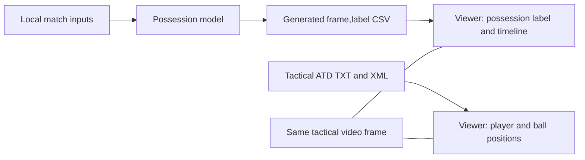

# Local 2D match viewer

Design for [issue #34](https://github.com/GTT-TalentArena/more-than-a-hack-2027/issues/34).

## What the viewer reads: model output versus tracking

**The viewer uses the model-generated CSV for possession.** The competition output has exactly two columns, `frame,label`, with one row per tactical video frame and a label of H, A, D or X. It contains no player or ball coordinates. See [the submission contract](../SUBMISSION.md).

| Displayed information | Source | Interpretation |
|---|---|---|
| Current H/A/D/X label, recent runs, timeline strip and window H/A share | The CSV passed through `--predictions` | Original model decisions, aligned by zero-based video frame |
| Solid player markers and the ball position | Tactical ATD TXT, interpreted with its XML metadata | Automatic input tracking, not positions generated by the possession model |
| Dashed player rings | A separate display-only estimate from nearby ATD observations | Visually marked estimates; never written into the CSV or fed back into inference |



For the authorised local session described below, `salidas/viewer-real/candidate_a.csv` was generated by `solution.a_opus` with its default configuration. This is a particular model run, not an automatic selection of the newest model or experiment. The viewer accepts another model's CSV if it passes the same official contract. No model is executed by the viewer itself.

**The CSV is read and validated once at startup.** Generating or replacing a CSV while the viewer is running does not update the loaded predictions. Stop the viewer and restart it with `--predictions` pointing to the desired generated file. For example, after generating the model output locally:

```powershell
python -m tools.match_viewer --data-dir "D:\mtah2027" --predictions "D:\private-results\candidate.csv" --port 8768
```

The label and the positions are joined at the same tactical video frame. Tactical ATD uses `frame_id - 1`; the submission CSV already uses zero-based `frame`. The broadcast/TV video has a separate timeline, cuts and replays, so its elapsed time cannot be compared directly with this map. A correct rendering of the ATD does not establish that an automatic ball detection is physically correct in the video, and a possession label cannot supply a missing ball coordinate. No CSV means no model prediction; the synthetic demo explicitly uses invented tracking and labels.

## Design fixed before implementation

The viewer reads tactical tracking and an optional prediction CSV. It displays original observations and labels, with an optional, separately marked estimate for short player gaps; it never changes model inference or edits a submission. A fully synthetic demo is the development and public illustration source.

Visual thesis: the GTT website's paper navigation and midnight stadium, with an oversized pitch, blue home markers and pink away markers. Content: source and observation legend, pitch workspace, model-label context and precise transport controls. Interaction: elapsed-time playback, stepping and seeking, and subtle control feedback; no decorative movement of observations.

Python serves a fixed allowlist of UI assets and a read-only frame API on `127.0.0.1`. Real ATD is validated and indexed in a background thread; only requested blocks reach the browser. The browser retains a bounded cache. Files and the index are not automatically persisted. No CDN, telemetry, remote fonts or external API is required.

Constants come from `games.py`. ATD frame IDs are converted with `starter.load_atd.video_frame_of`; positions follow `solution.contract.normalized_to_metres`. Metadata layout reuses the candidate A reader behind additional strict checks, without changing candidate code. Predictions use the official submission validator. Synthetic parity tests guard adapter differences.

## Validation plan

Test invented metadata and tracking, first/last frame alignment, coordinate conversion, missing observations, finite out-of-bounds positions, malformed inputs, CSV validation, HTTP isolation and bounded block sizes. Exercise playback and seeking in a real browser with synthetic data. Run the shared suite in Docker and benchmark an invented full-length ATD. Real-match performance and teammate acceptance remain separate local checks; no real match material is opened by the development agent.

## Scope

One prediction CSV, H/A/D/X, no prediction, missing observations, two teams, optional short player-gap estimates, play/pause, single-frame steps, timeline, frame jump and 0.25x/0.5x/1x/2x. No ball interpolation, trails, official evaluation metrics, manual corrections, export or candidate comparison.

## Website visual alignment

The viewer's visual reference is the team's existing [website pitch component](https://github.com/GTT-TalentArena/gtt-talentarena.github.io/blob/6c00001bb9a996f82b95d774b3fc1eca41a19565/components/pitch.tsx), its stadium colour tokens and `lib/fonts.ts`. The design uses paper navigation, midnight-blue stadium, home blue `#6b8cff`, away pink `#ff4f8a` and lime ball `#e8ff2e`. Geist is the body face, Geist Mono the data face, Bricolage Grotesque the display face and Instrument Serif the italic accent. The public site's Latin WOFF2 files and OFL notices are bundled locally; no font CDN is contacted at runtime.

Content plan: source and compact section title, explanatory legend on the left, pitch figure on the right, then precise transport controls. The figure places frame/FPS and the original label in its header and observation indicators below. Motion remains driven by source frames, with short control transitions and reduced-motion support. Unlike the illustrative website simulation, the real viewer does not invent stable goalkeeper identities, nearest-player ownership, missing-ball positions or trails.

The figure's possession strip, recent label runs and H/A share describe only the loaded CSV's preceding 40-second window within the current half. D and X remain explicit; the H/A share excludes them and is labelled as a window statistic. These are display summaries, not official evaluation metrics, and nothing is used to modify predictions. Public illustrations and screenshots continue to use synthetic data only.

Only this local viewer was changed. The website repository was read as a reference and its working tree remains unchanged. This change does not integrate or replace the website's pitch component.

Verification: fourteen viewer tests pass in both Docker/Linux and Windows, plus the three clock tests and synthetic browser checks. All four font families load locally. The updated real-session browser check passes forty seeks with the model-label window aligned to the tracking frame, zero external page requests and zero browser errors. Windows listeners now use exclusive binding to prevent old and new viewer processes from serving different versions on the same port. Synthetic desktop/mobile screenshots were reviewed; no real-match screenshot was captured.

## Run the viewer

From the repository root, use Python 3.11 or later with the shared dependencies. Node and Docker are not required to use the UI:

```powershell
py -3.11 -m venv .venv
.\.venv\Scripts\python.exe -m pip install -r docker/requirements.lock
.\.venv\Scripts\python.exe -m tools.match_viewer --synthetic
```

Open **http://127.0.0.1:8765**. Use `--port 8768` if the port is occupied. Stop with Ctrl+C. To exercise the state without a loaded CSV:

```powershell
.\.venv\Scripts\python.exe -m tools.match_viewer --synthetic --no-predictions
```

For authorised local inputs, replace these example paths. The bundle root must contain `tactical/` with `BAR-ATH_tactical_atd.xml` and `BAR-ATH_tactical_atd.txt`. Predictions are optional:

```powershell
.\.venv\Scripts\python.exe -m tools.match_viewer --data-dir "D:\mtah2027" --predictions "D:\private-results\candidate.csv"
```

Restart the command to change inputs. Loading is asynchronous and the page reports indexing progress or a sanitised error. Real inputs are read from the configured paths, never uploaded through an external service. The API refuses other hosts and origins, serves no arbitrary files, sends no CORS permission and disables browser caching. No persistent index or browser storage is used. Changing the TXT after indexing invalidates requests and requires a restart. The initial prediction CSV is a snapshot; changing it requires a restart too.

The server deliberately binds only to loopback. Run the UI directly on the host; Docker is used for reproducible checks, not for exposing a container service on the network.

## Use and interpretation

- Play/pause with the button or Space. Step one frame with the arrows. Use the slider or enter an exact zero-based frame. Speeds: 0.25x, 0.5x, 1x and 2x. Seeking pauses playback. At the end, Play returns to frame zero; press Play again to resume. Hiding the browser tab pauses playback.
- Time is from the beginning of the tactical video, not the official match clock. `games.half_video_blocks()` identifies the halves; no axes or observations are carried across them.
- Real sessions open at the first half's starting frame from `games.py`, so the initial view skips the pre-match video lead-in. The full timeline remains available, including frame zero and the last frame. The synthetic demo still opens at zero.
- H/A/D/X are the loaded model's original labels. X is abstention, D is dead ball and no CSV means no prediction. The viewer never forward-fills labels or infers a team. A missing ball is independent of those states.
- Missing ball observations stay hidden. Player gaps may be estimated as described below; halftime remains empty and long losses receive only a brief fading prediction. Slots identify export tracks, not people. There are no inferred names, shirt numbers or trails.
- Finite coordinates outside the pitch are retained. A margin displays nearby observations; the inspector reports observations outside the pitch. Extremely distant observations can fall outside the viewport, without clipping their coordinates to the touchline. Invalid or partially missing coordinate pairs are rejected rather than drawn at zero.
- Scrubbing loads bounded windows and ignores stale responses from earlier seeks. Playback waits for a missing block and resets its clock at that frame; slow storage can therefore reduce playback speed. Cached playback follows elapsed time, not redraw count. The browser keeps at most four 125-frame blocks, at most two tracking fetches (including prefetch), and one replaceable label-context fetch. Context and observations are displayed together for the same frame.

## Synthetic illustration for the public log



**Every position and label above is invented.** This looping illustration uses the current viewer's midnight palette, locally embedded typography, label window and transport layout. Dashed rings demonstrate the optional player estimates; the ball remains observation-only. It is a sampled synthetic demonstration, not a recording of the real match or a performance benchmark. Regenerate it with:

```powershell
python -m tools.match_viewer.preview
```

The illustration generator accepts no real data path. There is no real-match animation export in the UI.

All GitHub Actions workflows in this repository pin their Linux runner to `ubuntu-24.04`, including the viewer browser checks. The version is explicit rather than following the moving `ubuntu-latest` alias.

## Reproduce checks

Use the existing common Docker image (or build it once). These commands use invented fixtures and committed public references, not the restricted match:

```powershell
docker compose build
docker compose run --rm --entrypoint python evaluar -m unittest discover -s tests -v
docker compose run --rm --entrypoint python evaluar -m tools.match_viewer.benchmark
node --test tests/match_viewer_playback.test.mjs
```

Browser checks optionally need Node 22+ and the pinned Playwright dev dependency. From the root:

```powershell
Push-Location tools/match_viewer
npm ci
npx playwright install chromium
Pop-Location
$env:VIEWER_PYTHON = (Resolve-Path .venv/Scripts/python.exe).Path
node tests/match_viewer_browser.cjs
```

The checks start their own synthetic servers on ports 8766 and 8767 and shut them down afterward. To use an installed Chrome instead of downloading Chromium, set `$env:VIEWER_BROWSER_CHANNEL = "chrome"`. Screenshots go only to ignored `salidas/viewer-browser/`. CI runs the browser checks and clock tests in `.github/workflows/match-viewer.yml`; the existing Docker workflow discovers the Python tests.

## Verification · 23 October 2026

- Shared Docker image: Python 3.11.17, NumPy 2.4.6, pandas 3.0.6, Linux containers on Docker Desktop engine 29.9.2. **77 shared tests pass**, including ten new viewer tests, in 50.211 s. This branch starts from `65c3c70`, before the separate P2 smoothed-restart change.
- **Three JavaScript clock tests pass**: all speeds, elapsed time, pause/resume/seek, half boundaries, last-frame clamping and exact video time.
- **Synthetic browser checks pass** on Windows, Chrome 155.0.8059.85, Playwright 1.62.1. Checked H/A/D/X, no prediction, missing ball/player, half boundaries, first/last frame, stepping, play/pause (including a delayed frame fetch), speed controls, stale seek responses and 390-pixel mobile layout. Observed **zero external requests and zero browser errors**. Desktop and mobile screenshots were visually reviewed.
- Invented full-size benchmark: **199,319 frames, 46 slots, 95,362,696 bytes**. Index: **1,594,552 bytes**, **6.017 s**. Across 100 requested windows of up to 125 frames: **5.812 ms median**, **8.098 ms p95**. Those are adapter timings on synthetic coordinates, not browser latency, real-match measurements or peak memory. The fixture is created in a temporary directory and removed afterward.

## Remaining acceptance and limits

- [x] Technical local loading, full-frame decoding, navigation and external-request checks on the authorised match are recorded below. Reports contain only safe aggregate findings, with no observations, predictions, screenshots or match extracts returned to an LLM.
- [ ] Alejandro reviews privacy and integration; a different teammate follows this guide.
- [ ] GitHub CI passes on the published PR.

Until those checks are recorded, issue #34 remains open. The adapter has been checked against invented exports and the existing reader; actual export variants may need an explicit, tested adapter. There is no claim of model quality, official score improvement or real-match reconstruction accuracy. No model inference, metric or candidate configuration is changed.

## Authorised local-match verification · 23 October 2026

At the user's explicit request, the actual tactical XML/TXT pair and a freshly generated candidate A CSV were checked locally. Tools emitted only sanitised errors or aggregate reports. No real observations, labels, screenshots, traces or recordings were returned to the development model or published. The local reports are excluded from Git.

- The original adapter accepted the actual export without a format conversion or offset adjustment: **199,319 frames, 46 slots**. All **1,595 windows** were decoded and their indices validated. The scan counted **113,488 observed ball frames**, matching the aggregate documented in `DATA.md`.
- Candidate A (`solution.a_opus`, default configuration) generated a valid local CSV without evaluating any ground truth. SHA-256: `ab640ee8694f259697393d822b0a6665a017878b5b29d12715f59ec8a4dbc6d5`, matching the frozen candidate A reference. The generator ran in the bundled Windows Python environment; validation ran in the pinned Docker environment.
- Docker (Python 3.11.17, Linux): index **12.330 s**, full decoded scan **25.549 s**, index **1,594,552 bytes**. Per-window adapter time: **12.083 ms median / 21.394 ms p95**. The host viewer's separate indexing probe took **7.762 s**. These runs used different environments and overlapped with other work; they are observations, not a controlled speed comparison or peak-memory measurement.
- Local Chrome 155 / Playwright 1.62.1: **40 seeks** distributed through the video, including first/last frames, half boundaries and halftime. Tracking, prediction and observation indicators remained aligned. Playback, pause and mobile layout passed. **Zero external page requests and zero browser errors** were observed. Measured UI seek time: **40 ms median / 50 ms p95**, including automated control interaction on this machine.
- The usability fix opens actual sessions at the first half instead of the empty pre-match lead-in. Synthetic regression tests cover a nonzero initial frame without using match material.

Local evidence stays ignored under `salidas/viewer-real/`: the candidate CSV and generation log, `verification-docker.json` and `browser-verification.json`. Screenshots are deliberately not captured by the local-match check.

To reproduce aggregate validation, set the authorised data mount and run:

```powershell
$env:DATOS = "D:/mtah2027"
docker compose run --rm --entrypoint python modelo -m tools.match_viewer.verify --data-dir /datos --predictions /salidas/viewer-real/candidate_a.csv --out /salidas/viewer-real/new-verification.json
```

The output file must be new; reports are not overwritten. To check an already running local viewer with its CSV loaded, install the optional Playwright dependency described above and run:

```powershell
node tools/match_viewer/check_local_browser.cjs 8768
```

This check accepts only a loopback port, blocks nonlocal page requests and writes aggregates to ignored `salidas/viewer-real/browser-verification.json`. Unlike the synthetic browser suite, it never captures screenshots. Human football review, review by Alejandro and reproduction by a different teammate remain pending; issue #34 is not closed by these technical checks.


## Log · Ball fidelity and player estimates · 23 October 2026

The ball remains the original ATD observation at `video_frame = frame_id - 1`, converted to metres once, without axis flips, clipping, smoothing, interpolation or extrapolation. Missing observations remain explicit. The local verifier compares every ball frame and absence mask with the existing candidate A reader, allowing for that reader's float32 precision. This establishes reader consistency, not correctness against the physical ball in the video. Automatic tracking can still contain wrong detections and missing ball observations.

Player estimates are a display layer, enabled by default and controlled by **Estimate short player gaps**. Solid markers and **Observed tracks** count only original observations. Dashed team-colour rings and **Estimated tracks** identify estimates. Turning the option off restores the original display immediately. Loaded labels, model inputs and the submission CSV are unaffected.

The estimator bridges a missing run of at most **2 seconds** linearly between observations of the same export slot. It requires **three consecutive observed frames on each side**, all within one half, with at most **12 m/s** between anchor frames and over the bridge. Forward and backward projections from anchor velocities must each be within **3 + 3 × gap duration in seconds** metres of the opposite endpoint. These are fixed display heuristics, not parameters fitted to possession labels or a guarantee of player identity.

A candidate is rejected if its team is absent or already has eleven observed tracks, or if it passes within **0.8 m** of another observed same-team track. Competing estimates closer than 0.8 m are suppressed together; estimates that would exceed eleven tracks for a team are also suppressed together. The estimator never constructs a full missing team and never joins the two halves.

Local aggregate diagnostics showed no bounded same-slot gaps short enough for the two-second bridge in this match. To soften actual track losses, a long gap may instead receive up to **0.6 seconds** of forward prediction from the preceding three observed frames, subject to the same speed, team and duplicate checks. Velocity decreases linearly to zero: displacement at time `t` is `v × (t - t² / (2 × 0.6))`. The marker fades each frame; its display weight is not a probability. At 25 fps, prediction lasts at most fifteen frames, with at most 3.6 metres of displacement under the speed cap. The rest of the long gap stays missing. The grace period is suppressed if it would cross a half boundary. No earlier position is invented when a track first appears.

A bounded halo supplies anchors so estimates agree across API block boundaries and direct single-frame seeks. Original `players` and `ball` fields are preserved. `player_estimates` contains separate coordinates or nulls for each slot; `player_estimate_fade` carries 1 for a two-ended bridge, decreasing weights for brief predictions and 0 for unavailable estimates.

Synthetic example (all positions invented):

```text
                    original observations
                          ↓         ↓
slot H-4:          ● ─ ─ ◌ ─ ◌ ─ ◌ ─ ●
                         short gap ≤ 2 s
                         dashed = estimated

long track loss:   ● ─ ◌ ─ ◌ ─ ◌       · · ·
                      ≤ 0.6 s fade     stays missing

ball observed:     ●     ●     ·     ●     ●
                               ↑
                         no observation
                         no invented position
```

Regression checks cover gap limits, first/last-frame absences, half boundaries, excessive speeds, unstable endpoints, apparent identity jumps, duplicates, team capacity, empty teams, unchanged inputs and single-frame/block consistency. Grace-period tests check deceleration, decreasing display weights and its hard time limit. Browser instrumentation checks the actual filled ball circle against the API's current-frame coordinate and pitch transform, including missing and out-of-bounds cases. The probe stays inside the local browser; real-match checks return booleans and aggregates only, without screenshots or traces.

Full local verification passed on **199,319 frames / 1,595 windows**: all ball positions and absence masks agree with the reference reader; all original observations remain unchanged by estimation. The display adds **12,193 estimated player samples across 10,643 frames**, representing brief continuity rather than recovered ground truth. The prediction CSV hash remains `ab640ee8694f259697393d822b0a6665a017878b5b29d12715f59ec8a4dbc6d5`. The ignored aggregate report is `salidas/viewer-real/ball-and-estimation-verification-v2.json`.

Final validation: **21 viewer Python tests pass on Windows and in Docker**, plus the three playback tests and the synthetic browser checks. The real browser passes forty seeks with ball canvas/source parity, estimate counts, a nonempty estimated frame compared with the original view, the toggle, playback, pause and mobile layout. No external requests or browser errors were observed. Its aggregate report stays in `salidas/viewer-real/browser-verification.json`. Only safe aggregate findings are shared; the website repository remains a read-only reference.

## Log · Model CSV clarification and PR verification · 24 October 2026

The data-source table and diagram at the start of this guide distinguish possession predictions from map geometry. The UI now explicitly states that possession comes from the loaded model CSV, positions come from tactical ATD, and the CSV is a startup snapshot. The local candidate A example is not an automatic choice of the team's latest experiment. To inspect a new run, restart with that run's `--predictions` path.

After incorporating `main` at `76bdb97`, the full shared Docker suite passes **98 tests in 55.058 seconds**, including all 21 viewer tests. The three elapsed-time playback tests and synthetic desktop/mobile browser checks also pass, with zero external requests and zero browser errors. These checks use invented fixtures and committed public references, not a new real-match scoring run. This PR does not change any candidate, prediction CSV, evaluation rule or website component.
